# NBA 2K17 MyTEAM

Browse the NBA 2K17 card archive, create custom cards, draft or build teams, and inject lineups into a locally loaded roster. Card Studio is built into the main application.

**[Download the Windows release](https://github.com/jpallen2828/nba-2k17-myteam-viewer/releases/latest)**

Download `NBA.2K17.MyTEAM.zip`, choose **Extract All**, and run `2K17 MyTEAM.exe` from the extracted folder. Keep the included `.project` data folder beside the EXE. No Python installation is needed.

## Screenshots

<table>
<tr><td width="50%">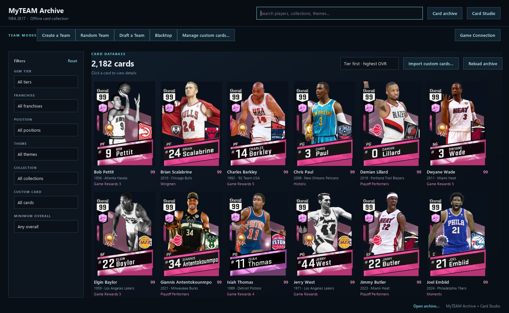<br>Browse the card archive</td><td width="50%">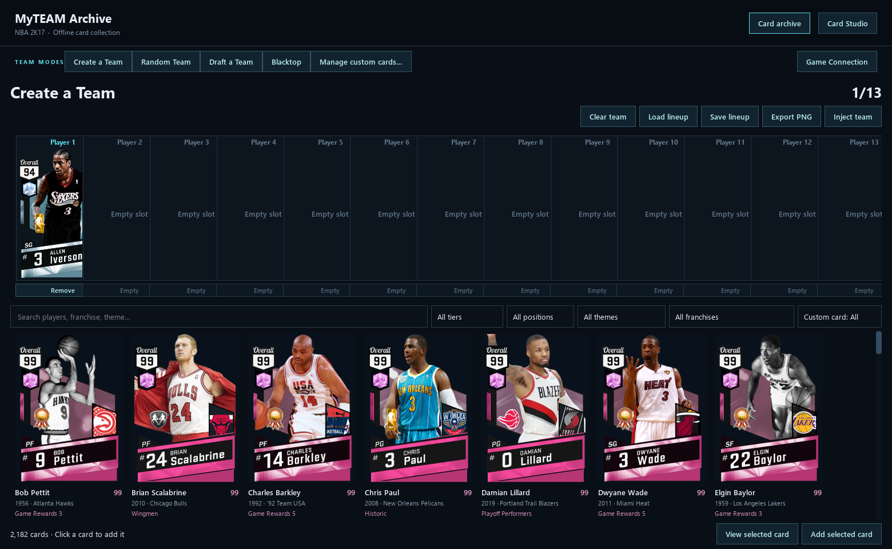<br>Create a team</td></tr>
<tr><td>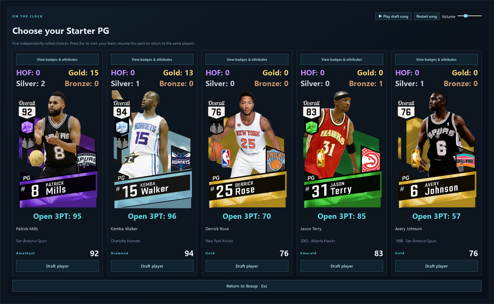<br>Draft a lineup</td><td>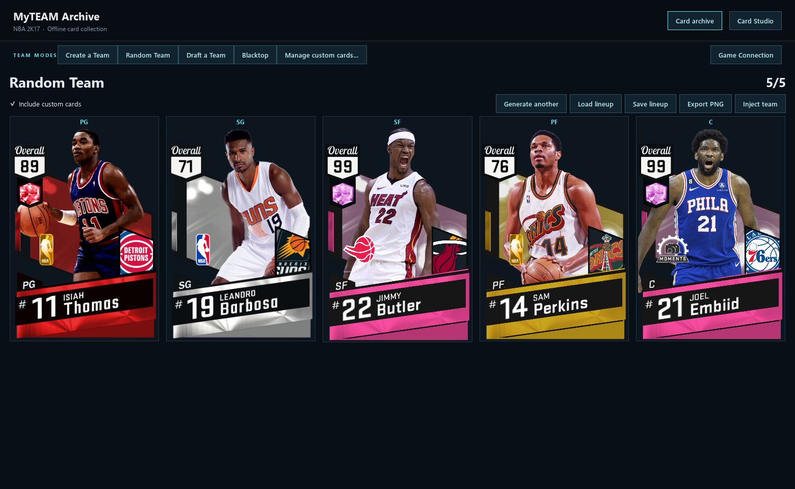<br>Generate a random team</td></tr>
<tr><td>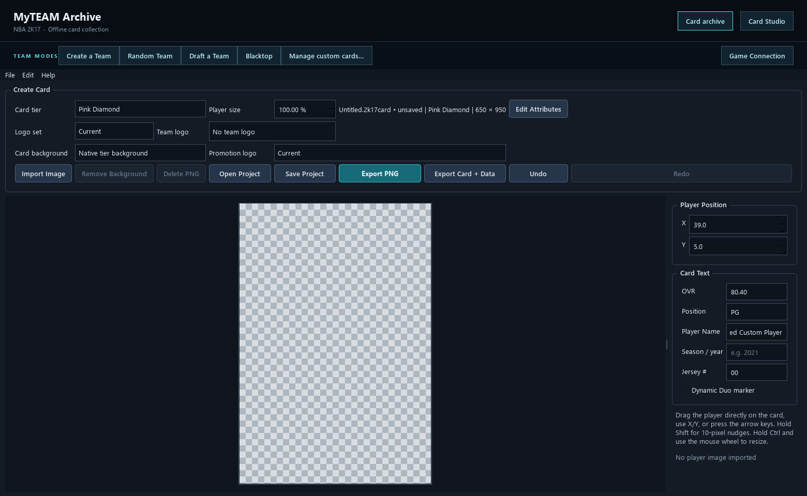<br>Create custom cards</td><td>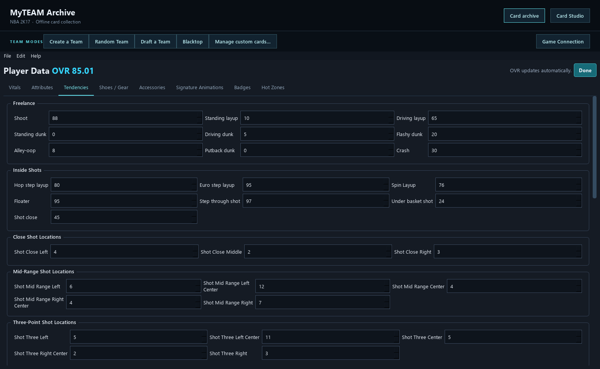<br>Edit player data</td></tr>
<tr><td>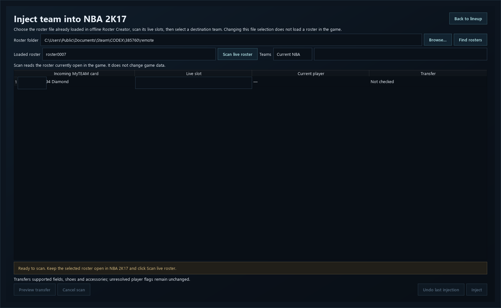<br>Prepare a roster injection</td><td>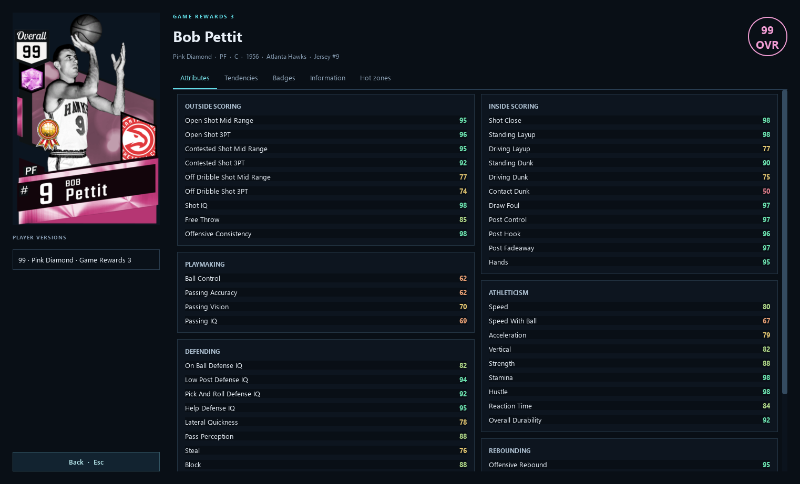<br>Inspect player ratings</td></tr>
<tr><td>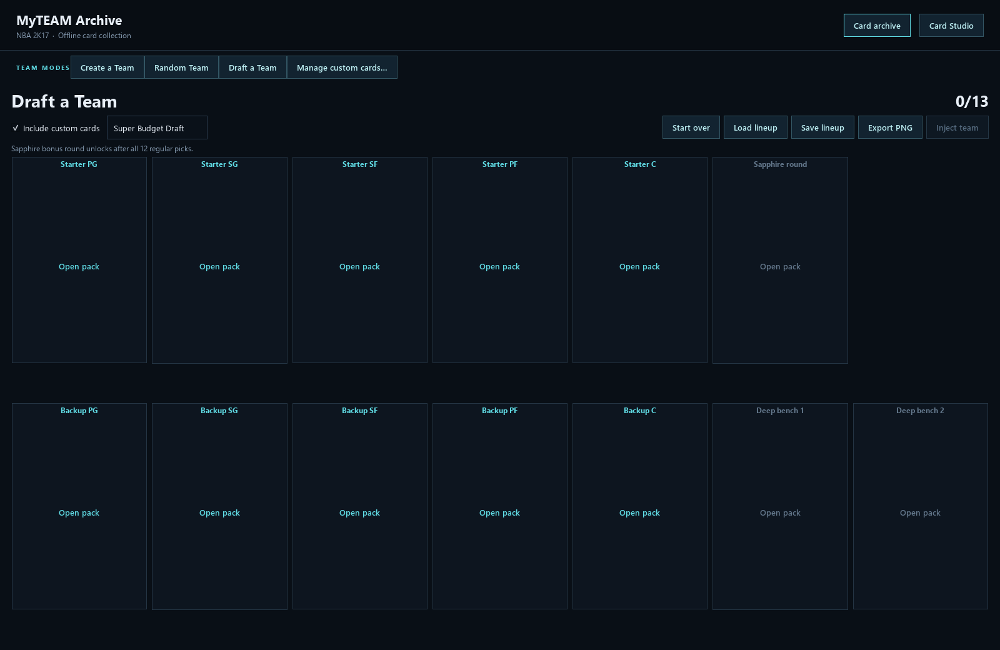<br>Super Budget draft</td><td>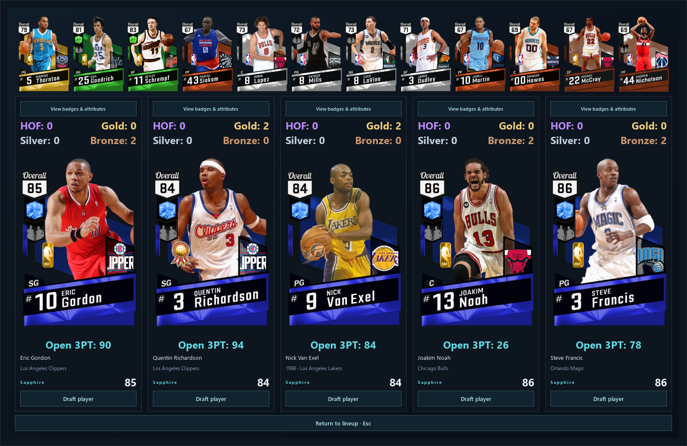<br>Sapphire bonus round</td></tr>
<tr><td>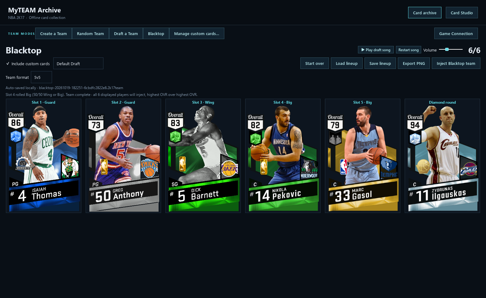<br>Blacktop teams and draft music</td><td>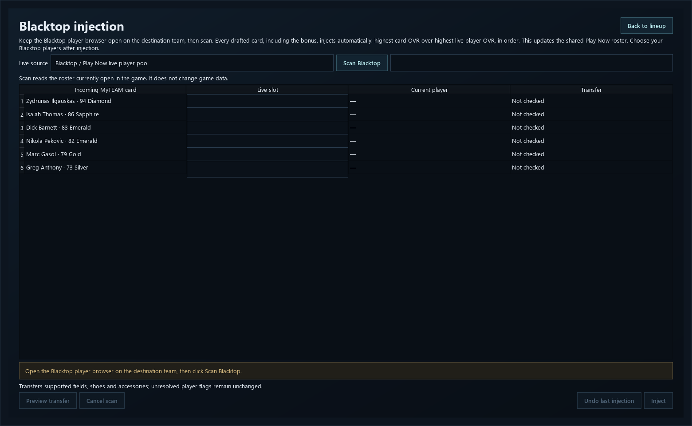<br>Inject every Blacktop pick</td></tr>
<tr><td>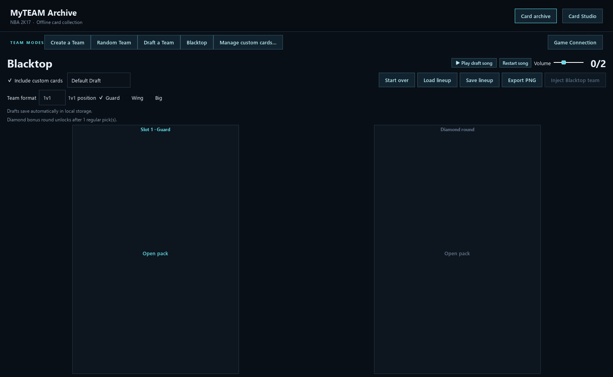<br>Choose a Blacktop format and roles</td><td>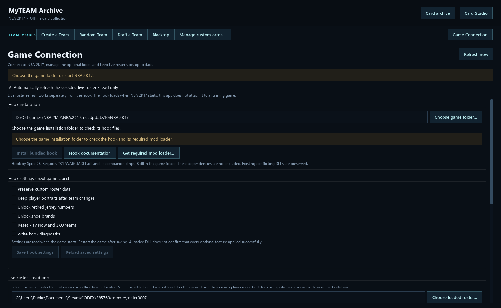<br>Game Connection and optional hook</td></tr>
</table>

## Included

- 2,182 available cards in v1.3.0, including all currently saved custom cards.
- Original PNG artwork, preserved byte-for-byte. ZIP compression is lossless.
- Filters for tiers, teams, positions, themes, collections, overall, and custom cards.
- Create a Team, Random Team, Draft a Team, and dedicated Blacktop modes.
- Blacktop supports 1v1 through 5v5, position roles, all four draft settings, and a bonus round. Every drafted card, including the bonus, can be injected.
- Blacktop assigns the highest-overall incoming card to the highest-overall destination, continuing in descending order.
- Traditional and Blacktop drafts save automatically, including pending choices, so you can resume them.
- Optional draft music with Play/Pause, Restart, and a volume slider.
- Four draft settings: Baller, Default, Budget, and Super Budget. Hover over the setting for odds per choice.
- Super Budget favors lower tiers and ends with a Sapphire round (98.889% Sapphire, with small chances of Ruby through Pink Diamond).
- Draft choices show badge-tier counts and Open 3PT ratings, including final Diamond/Amethyst/Sapphire rounds.
- Integrated Card Studio with editable ratings, tendencies, signatures, shoes, accessories, badges, and hot zones.
- Custom-card imports, disable/re-enable/remove controls, and editable teams and years.
- Saved reusable player templates for injection, with preview, verification, and undo.
- Game Connection page with optional hook setup, startup settings, and automatic live roster refresh.

## Requirements and compatibility

- 64-bit Windows 10 or Windows 11.
- Browse cards and use Card Studio offline without NBA 2K17 installed.
- Injection requires your own Windows installation of NBA 2K17, running with the intended roster loaded in offline Roster Creator, or on the supported Play Now Blacktop player browser for Blacktop injection.
- The injector verifies the game executable and destination structures. Not every NBA 2K17 executable build has been validated. An unsupported-build error is not permission to bypass those checks.
- Modded players can use saved templates without appearing in the destination roster, but their external face/portrait assets must already be installed where required. Those game assets are not supplied here.

## Inject a team

1. Start NBA 2K17 and load the roster you intend to edit in Roster Creator.
2. Build, draft, or generate a lineup in MyTEAM.
3. Open **Inject team**. Browse to your roster folder if it was not detected.
4. Select the matching roster file, scan the live roster, and choose a destination team.
5. Review the selected slots, then press **Inject**. Ownership checks run automatically when needed.
6. Check the result in the game and save your roster. The app's file selection does not load a roster in NBA 2K17.

Use a separate saved roster for experiments. Undo applies to the current supported injection session; it is not a replacement for a saved roster.

## Blacktop

Open **Blacktop** beside **Draft a Team**. Select a team format, draft setting, and the Guard/Wing/Big role for 1v1. The other formats use their designated role layouts; the fourth slot in 5v5 rolls Wing or Big once per draft.

Draft the regular slots and the bonus round. **Inject Blacktop team** includes every displayed card: two cards for a completed 1v1 draft, up to six for 5v5. In NBA 2K17, open the Play Now Blacktop player browser and select the destination team. The app binds directly to that live roster without a roster-file selection. It automatically pairs incoming and destination players by descending overall. This edits the shared Play Now player pool; select your desired participants in the game afterward.

Drafts save under `%LOCALAPPDATA%\NBA2K17MyTEAM\Drafts`, in separate `Blacktop` and `Traditional` folders. **Load lineup** lets you resume a saved draft. The optional draft song starts only when you press Play.

See [Card Studio](CARD_STUDIO.md), [updating](UPDATING.md), and [release notes](RELEASE_NOTES.md).

## Game Connection and the optional hook

Open **Game Connection** from the top navigation. The app detects a running NBA 2K17 process, or you can choose its installation folder. **Install bundled hook** checks the supported game build and existing files before installing Spree#8's hook. Close the game first. The installer derives the reviewed compatibility profile only for the exact supported executable. The required `2K17WAIGUADLL.dll` and companion `dinput8.dll` are not supplied; conflicting existing DLLs are not replaced.

The hook supports modded assets absent from the game manifest, preserving custom roster data, keeping available portraits after team changes, unlocking retired numbers, and unlocking shoe brands. Set its switches on this page and restart NBA 2K17. Installed files, loaded modules, and next-launch settings are reported separately; older log messages do not prove a feature is active in the current session.

Choose the roster file currently open in offline Roster Creator. Automatic refresh reads the live roster while both applications are open and shares the injection screen's selected roster and session. It waits during injection and Undo. Cards are applied only when you press **Inject**. A stopped game or replaced roster requires a new verified binding; an old session's Undo cannot cross that boundary. You can pause automatic refresh and use **Refresh now** instead.

The supplied hook has no exposed runtime control API, so its settings cannot be hot-reloaded. Launch the game from its installation folder so it can find the hook configuration. See **Hook documentation** on the connection page for the original author's instructions and distribution terms.

## Build from source

Use Windows and Python 3.13. Download the optional `NBA.2K17.Build.Resources.zip` from the same release and extract it. It contains the matching Studio resources and local background-removal model.

```powershell
py -3.13 -m pip install -r requirements.txt
py -3.13 tools/build_release.py --resources "C:\path\to\NBA 2K17 Build Resources"
```

The built EXE appears in `dist`. To run it, place it in an extracted MyTEAM release folder alongside the supplied database and artwork. The source repository does not contain those large release datasets.

## Support

Use [Issues](https://github.com/jpallen2828/nba-2k17-myteam-viewer/issues) and include the app version, exact error message, affected card/team, and steps to reproduce. Review diagnostic files before sharing them; they can contain local paths.

This is an independent fan project, not affiliated with or endorsed by 2K, Take-Two, the NBA, or the NBPA. See [third-party notices](THIRD_PARTY_AND_RIGHTS.md) and [game-file exclusions](GAME_FILES_NOT_INCLUDED.md).
