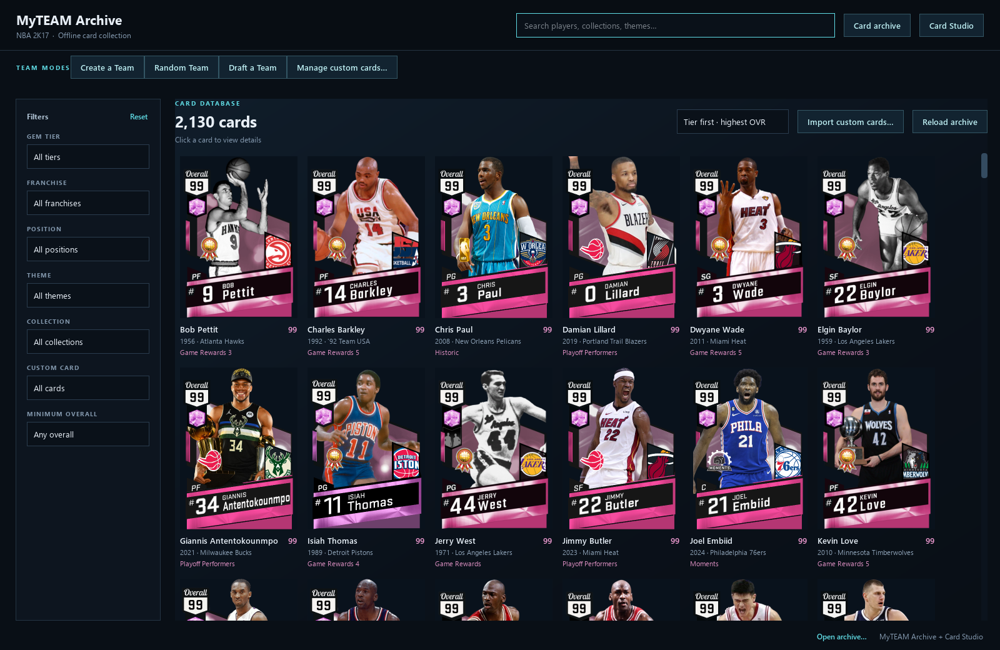
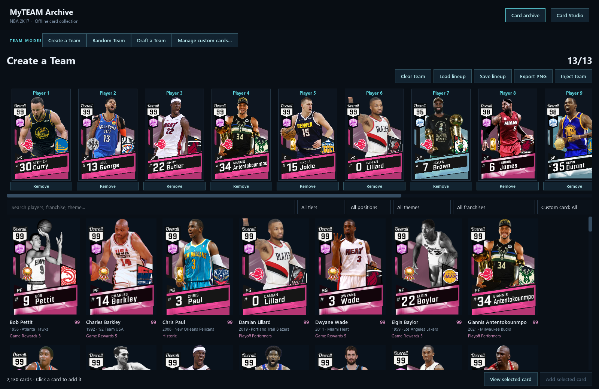
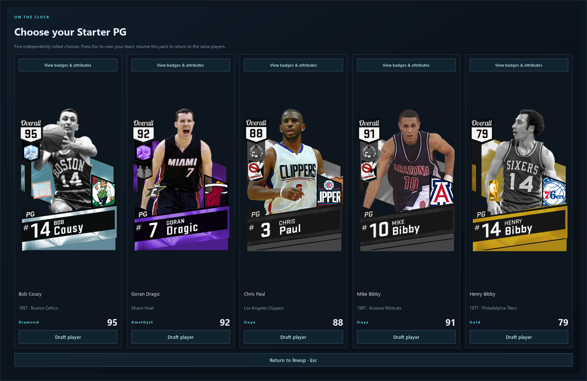
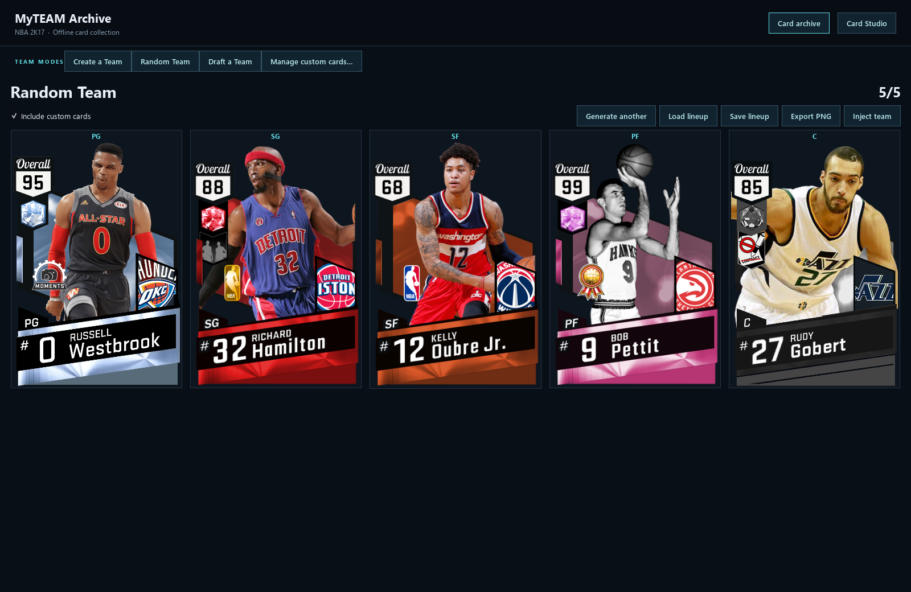
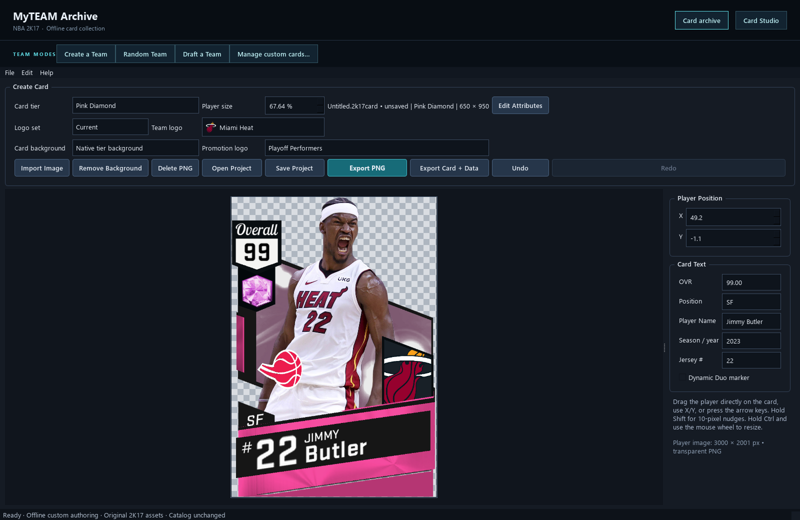
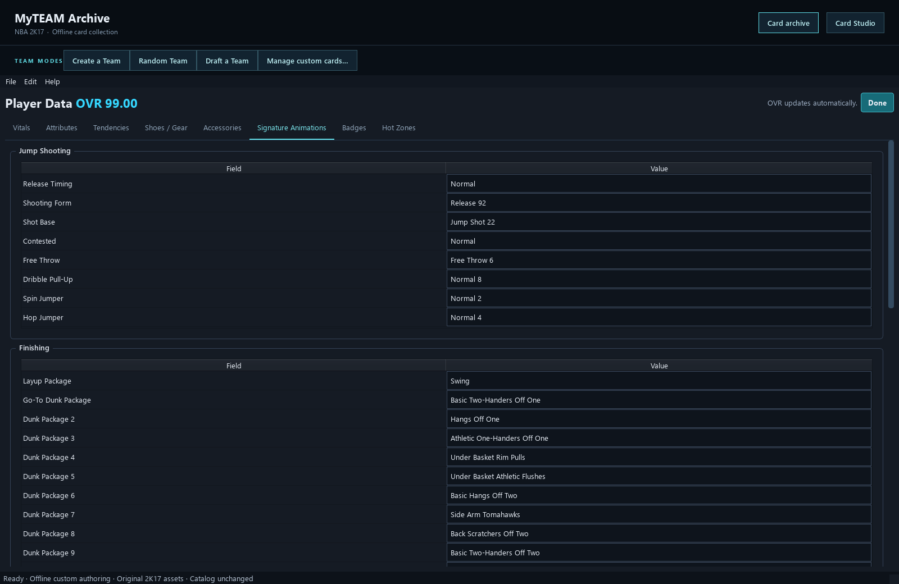
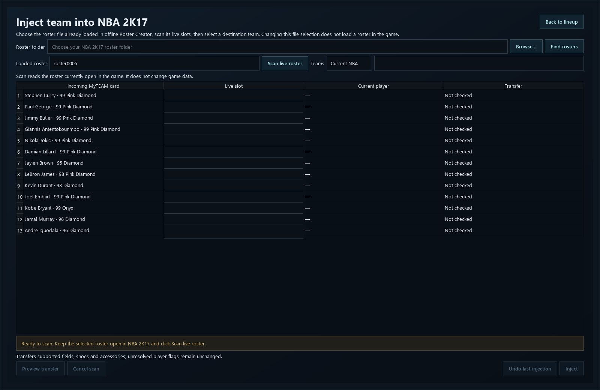
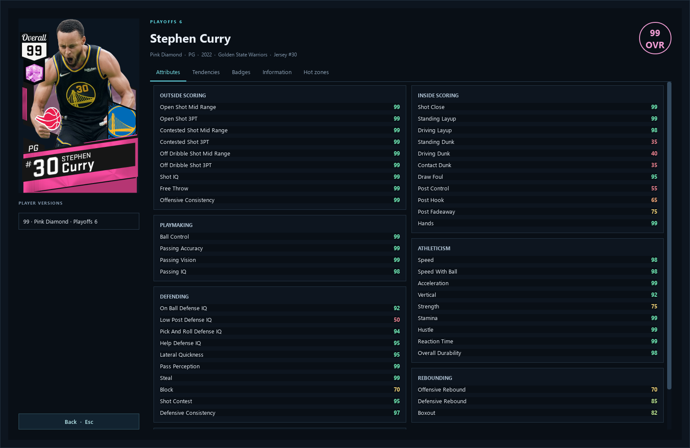

# NBA 2K17 MyTEAM

Browse the NBA 2K17 card archive, create custom cards, draft or build teams, and inject lineups into a locally loaded roster. Card Studio is built into the main application.

**[Download the Windows release](https://github.com/jpallen2828/nba-2k17-myteam-viewer/releases/latest)**

Download `NBA.2K17.MyTEAM.zip`, choose **Extract All**, and run `2K17 MyTEAM.exe` from the extracted folder. Keep the included `.project` data folder beside the EXE. No Python installation is needed.

## Screenshots

<table>
<tr><td width="50%"><br>Browse the card archive</td><td width="50%"><br>Create a team</td></tr>
<tr><td><br>Draft a lineup</td><td><br>Generate a random team</td></tr>
<tr><td><br>Create custom cards</td><td><br>Edit player data</td></tr>
<tr><td><br>Prepare a roster injection</td><td><br>Inspect player ratings</td></tr>
</table>

## Included

- 2,130 available cards in the initial release, including the latest custom cards.
- Original PNG artwork, preserved byte-for-byte. ZIP compression is lossless.
- Filters for tiers, teams, positions, themes, collections, overall, and custom cards.
- Create a Team, Random Team, and Draft a Team modes.
- Integrated Card Studio with editable ratings, tendencies, signatures, shoes, accessories, badges, and hot zones.
- Custom-card imports, disable/re-enable/remove controls, and editable teams and years.
- Saved reusable player templates for injection, with preview, verification, and undo.

## Requirements and compatibility

- 64-bit Windows 10 or Windows 11.
- Browse cards and use Card Studio offline without NBA 2K17 installed.
- Injection requires your own Windows installation of NBA 2K17, running with the intended roster loaded in offline Roster Creator.
- The injector verifies the game executable and destination structures. Not every NBA 2K17 executable build has been validated. An unsupported-build error is not permission to bypass those checks.
- Modded players can use saved templates without appearing in the destination roster, but their external face/portrait assets must already be installed where required. Those game assets are not supplied here.

## Inject a team

1. Start NBA 2K17 and load the roster you intend to edit in Roster Creator.
2. Build, draft, or generate a lineup in MyTEAM.
3. Open **Inject team**. Browse to your roster folder if it was not detected.
4. Select the matching roster file, scan the live roster, and choose a destination team.
5. Review the selected slots, then press **Inject**. Ownership checks run automatically when needed.
6. Check the result in the game and save your roster. The app's file selection does not load a roster in NBA 2K17.

Use a separate saved roster for experiments. Undo applies to the current supported injection session; it is not a replacement for a saved roster.

See [Card Studio](CARD_STUDIO.md), [updating](UPDATING.md), and [release notes](RELEASE_NOTES.md).

## Build from source

Use Windows and Python 3.13. Download the optional `NBA.2K17.Build.Resources.zip` from the same release and extract it. It contains the matching Studio resources and local background-removal model.

```powershell
py -3.13 -m pip install -r requirements.txt
py -3.13 tools/build_release.py --resources "C:\path\to\NBA 2K17 Build Resources"
```

The built EXE appears in `dist`. To run it, place it in an extracted MyTEAM release folder alongside the supplied database and artwork. The source repository does not contain those large release datasets.

## Support

Use [Issues](https://github.com/jpallen2828/nba-2k17-myteam-viewer/issues) and include the app version, exact error message, affected card/team, and steps to reproduce. Review diagnostic files before sharing them; they can contain local paths.

This is an independent fan project, not affiliated with or endorsed by 2K, Take-Two, the NBA, or the NBPA. See [third-party notices](THIRD_PARTY_AND_RIGHTS.md) and [game-file exclusions](GAME_FILES_NOT_INCLUDED.md).
